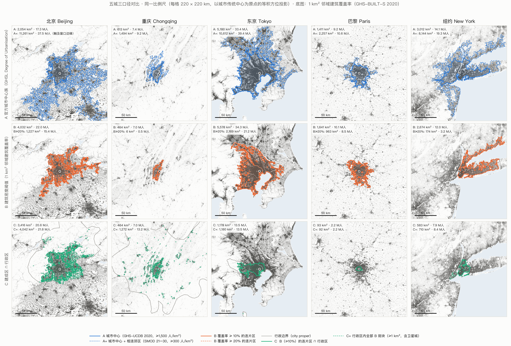
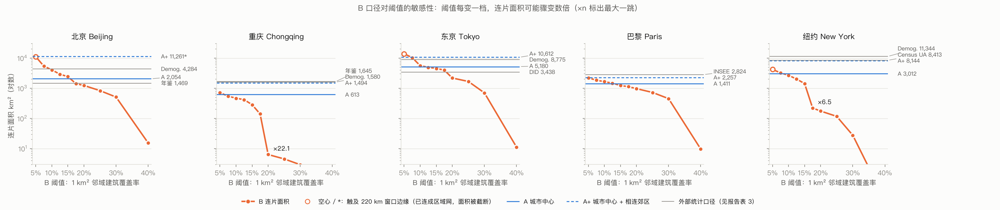
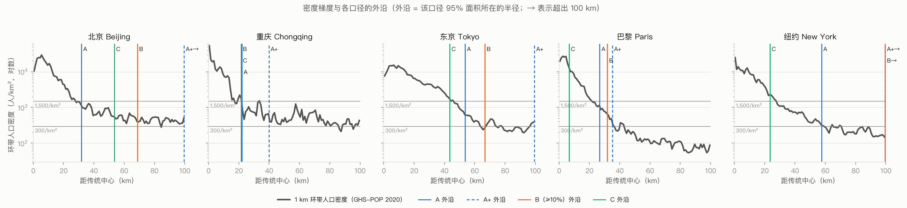

# P1 城市口径对比：北京 · 重庆 · 东京 · 巴黎 · 纽约

> 2026-10-25 · 数据年份 2020 · 全部数字可由 `pipeline/` 一条命令复现（见文末）
> 输出：[`pipeline/out/p1/`](../pipeline/out/p1/)（指标 CSV、边界 GeoJSON、三张图）

## 结论

**建议 v2 只用一个统计口径：A，GHSL 城市中心（Degree of Urbanisation）。** 其余三种降级为辅助视图：

- **A+** 只做背景分级，不画成边界。
- **B** 只做底图纹理，不当定义。
- **C** 只用来按行政区拆分连绵区。

证据：

1. **A 可以精确复现，而且不用我们调任何参数。** 我们从原始栅格重算的面积和人口，与官方 UCDB 相差不超过 0.4%（表 2）。它的阈值 1,500 人/km² 是 2020 年联合国统计委员会采纳的国际标准，不由我们选择。旧版"选择标准不明确"的问题由此消失。
2. **A 与各国"密集城区"的人口统计吻合。**
   - 东京 A 为 33.42 M，日本 2020 年普查 1都3県 的人口集中地区（DID）合计 33.41 M。
   - 北京 A 为 17.33 M，七普城区常住人口为 17.75 M。
3. **B 对阈值极其敏感，无法用于跨城比较**（图 2）。
   - 纽约：阈值从 15% 调到 17.5%，连片面积从 1,423 km² 降到 219 km²（×6.5）。
   - 重庆：阈值从 17.5% 调到 20%，面积缩小 22 倍。
   - 阈值从 10% 调到 20%，纽约与巴黎的面积比从 1.6 变成 0.18，排名直接翻转。
   - 原因：连片区在河流和山脊处成片断开（渗流断裂）。每座城市断开的临界阈值都不同，所以不存在一个对所有城市都公平的阈值。
4. **C 比的是行政区划，不是城市。**
   - 行政单元本身就差 150 倍：北京市 16,410 km²，巴黎市 105 km²。
   - 巴黎的 C 只有 93 km²，是其 A 的 7%；北京的 C 为 3,416 km²，反而比 A 大 66%。
5. **A+（城市中心加上 ≥300 人/km² 的相连郊区）在人口稠密的农区会失效。**
   - 在纽约、巴黎、重庆，A+ 接近各国的城市区统计。例如纽约 A+ 为 8,144 km²，人口普查城市区为 8,413 km²。
   - 在北京，A+ 穿过华北平原的稠密村庄，一路连到 220 km 窗口边缘（11,261 km²，被截断）。
   - 同一条规则在高人口密度的农区（华北平原、恒河平原、爪哇……）会失效，所以 A+ 不能作为全球统一的边界。

## 选 A 意味着什么（需要你拍板的产品后果）

- **连绵区就是一个城市**（表 5）。
  - 合并的例子：广州、深圳、佛山、东莞合为一个城市中心（6,250 km²，41.2 M）；大阪、神户、京都合为一个（2,234 km²，13.3 M）；苏州和无锡合为一个；横滨属于东京。
  - 分开的例子：阿姆斯特丹与鹿特丹–海牙是两个城市中心，华盛顿与巴尔的摩也是。
  - 这是数据本身的判断，不再需要旧版的"影子种子 + 垂直平分线"。
- **需要"深圳 vs 广州"时，用 A ∩ 行政区作二级视图。** 例如"城市中心位于深圳市境内的部分"。这条规则一句话就能讲清楚，也能复现。
- **A 衡量的是密集城区，低密度郊区不计入面积。**
  - 例如纽约 A 为 3,012 km²，人口普查城市区为 8,413 km²。这是可比性的代价。
  - 郊区可以用 SMOD 分级（城市中心 / 城市集群 / 郊区 / 农村）作为背景着色，让人看得见，但不算进面积。
- **时间维度不用额外工作。** UCDB 提供 1975–2030 每 5 年一期的边界、面积和人口（表 4）。例如北京城市中心从 834 km² 扩到 2,056 km²。
- **与旧版对比，旧版各城的面积倍数很不一致。**

  | 城市 | 旧版面积 | A 面积 | 旧版 / A |
  |---|---|---|---|
  | 东京 | 18,894 km² | 5,180 km² | 3.6 倍 |
  | 巴黎 | 3,315 km² | 1,411 km² | 2.3 倍 |
  | 纽约 | 6,591 km² | 3,012 km² | 2.2 倍 |
  | 北京 | 2,762 km² | 2,054 km² | 1.3 倍 |
  | 重庆 | 406 km² | 613 km² | 0.66 倍 |

  这就是旧版"口径不一致"的量化表现。

## 方法

| 项目 | 做法 |
|---|---|
| 分析网格 | 每座城市各自用一个以传统中心为原点的 Lambert 等积方位投影（LAEA），100 m 网格，范围 ±110 km。面积精确，距离误差约 0.1%，这也是 v2 前端将使用的坐标系 |
| 中心点 | 天安门、解放碑、东京站、巴黎零公里点（圣母院前）、纽约市政厅 |
| 建成数据 | GHS-BUILT-S R2023A，2020 年，100 m（单位为每公顷的建筑屋顶面积，m²） |
| 人口数据 | GHS-POP R2023A，2020 年，100 m |
| A | GHS-UCDB R2024A v1.2 的 2020 年城市中心多边形（MTUC 图层），取包含中心点的那个。A* 是用 GHS-SMOD class 30 加四邻接自己重推的结果，仅作校验 |
| A+ | GHS-SMOD class 21–30（≥300 人/km²）中包含中心点的四邻接连通区 |
| B | 计算每个 100 m 格子周围 1 km² 圆形邻域（r = 564 m，沿用 Atlas of Urban Expansion 的"步行圈"）的建筑覆盖率；取 ≥ 阈值、包含中心点的八邻接连通区，再填平小于 200 ha 的内部空地。默认阈值 10% 只是折中值，没有原则性依据：5% 时北京、东京、纽约已连到窗口边缘，7.5% 时东京已扩到 10,272 km²（图 2）。找不到有依据的阈值，本身就是 B 的问题 |
| C | B 与行政单元（city proper）的交集：北京市、重庆市、东京都、巴黎市（75）、纽约市五区（geoBoundaries） |
| C+ | 行政单元内全部 ≥1 km² 的 B 斑块，包含卫星城。这最接近中国"建成区"的统计口径 |
| 紧凑度 | Angel 等（2010）的 proximity index：1 表示正圆，数值越低越狭长或越破碎 |

⚠️ GHS-BUILT-S 记录的是建筑屋顶面积，不是不透水地面。A 内部 1 km² 邻域覆盖率的中位数只有 19–30%，所以 Atlas 的 25% / 50% 阈值（基于"建成像元"）不能直接搬过来用。B 的阈值必须重新标定，而这本身就是 B 的弱点。

## 结果

### 表 1　五城 × 五口径（2020）

| 口径 | 城市 | 面积 km² | 人口 M | 人口密度 /km² | 建筑覆盖率 | 斑块数 | 95% 外沿 km | 紧凑度 | 触窗口边缘 |
|---|---|---|---|---|---|---|---|---|---|
| A | 北京 | 2,054 | 17.33 | 8,441 | 26% | 2 | 32 | 0.95 |  |
| A | 重庆 | 613 | 7.39 | 12,066 | 19% | 2 | 22 | 0.86 |  |
| A | 东京 | 5,180 | 33.42 | 6,453 | 28% | 1 | 54 | 0.90 |  |
| A | 巴黎 | 1,411 | 9.18 | 6,510 | 25% | 1 | 27 | 0.95 |  |
| A | 纽约 | 3,012 | 14.08 | 4,675 | 23% | 1 | 58 | 0.78 |  |
| A+ | 北京 | 11,261 | 37.46 | 3,326 | 17% | 1 | 121 | 0.70 | 是 |
| A+ | 重庆 | 1,494 | 9.20 | 6,159 | 12% | 1 | 40 | 0.81 |  |
| A+ | 东京 | 10,612 | 39.42 | 3,715 | 22% | 1 | 99 | 0.83 |  |
| A+ | 巴黎 | 2,257 | 10.62 | 4,703 | 21% | 1 | 35 | 0.89 |  |
| A+ | 纽约 | 8,144 | 19.30 | 2,369 | 16% | 1 | 100 | 0.71 |  |
| B | 北京 | 4,032 | 22.03 | 5,464 | 24% | 1 | 69 | 0.75 |  |
| B | 重庆 | 464 | 6.98 | 15,027 | 24% | 1 | 22 | 0.77 |  |
| B | 东京 | 5,578 | 34.32 | 6,152 | 29% | 1 | 67 | 0.85 |  |
| B | 巴黎 | 1,641 | 10.06 | 6,130 | 26% | 1 | 32 | 0.86 |  |
| B | 纽约 | 2,674 | 11.99 | 4,484 | 23% | 1 | 111 | 0.60 |  |
| C | 北京 | 3,416 | 20.63 | 6,037 | 24% | 6 | 54 | 0.84 |  |
| C | 重庆 | 464 | 6.98 | 15,027 | 24% | 1 | 22 | 0.77 |  |
| C | 东京 | 1,178 | 13.51 | 11,468 | 34% | 12 | 44 | 0.80 |  |
| C | 巴黎 | 93 | 2.24 | 24,062 | 36% | 4 | 7 | 0.95 |  |
| C | 纽约 | 583 | 7.89 | 13,541 | 31% | 3 | 23 | 0.89 |  |
| C+ | 北京 | 4,042 | 21.81 | 5,395 | 24% | 148 | 63 | 0.82 |  |
| C+ | 重庆 | 1,272 | 13.16 | 10,343 | 21% | 128 | 85 | 0.41 |  |
| C+ | 东京 | 1,180 | 13.53 | 11,466 | 34% | 8 | 44 | 0.79 |  |
| C+ | 巴黎 | 92 | 2.24 | 24,328 | 36% | 1 | 6 | 0.96 |  |
| C+ | 纽约 | 710 | 8.39 | 11,831 | 29% | 7 | 24 | 0.77 |  |

北京、重庆的 C+ 受 220 km 窗口限制。重庆市辖区远超窗口（万州、涪陵等不在其中），所以 C+ 偏小。

### 表 2　A 的复现校验（我们重算 vs 官方 UCDB）

| 城市 | UCDB 城市中心 | 官方面积 | 我们重算 | A*（SMOD 重推） | 官方人口 M | 我们重算 M |
|---|---|---|---|---|---|---|
| 北京 | Beijing (#8745) | 2,056 | 2,054 (−0.1%) | 2,029 | 17.36 | 17.33 (−0.1%) |
| 重庆 | Chongqing (#8557) | 615 | 613 (−0.4%) | 588 | 7.42 | 7.39 (−0.4%) |
| 东京 | Tokyo (#5929) | 5,191 | 5,180 (−0.2%) | 5,253 | 33.50 | 33.42 (−0.2%) |
| 巴黎 | Paris (#2878) | 1,410 | 1,411 (+0.0%) | 1,412 | 9.18 | 9.18 (+0.1%) |
| 纽约 | New York City (#8099) | 3,014 | 3,012 (−0.1%) | 3,010 | 14.09 | 14.08 (−0.1%) |

### 表 3　外部统计口径对照

完整来源与原文引述见 [`pipeline/references/p1_reference_figures.csv`](../pipeline/references/p1_reference_figures.csv)。标"二手"的数字取自转载页，未对照原始年鉴或普查表。

| 城市 | 外部口径 | 面积 km² | 人口 M | 最接近的口径 |
|---|---|---|---|---|
| 北京 | 城市建设统计年鉴 建成区（二手，可能是 2019 年值） | 1,469 | — | 无（A 2,054；年鉴是行政上报口径） |
| 北京 | 七普 城区常住人口（二手） | — | 17.75 | **A 17.33** |
| 北京 | Demographia 2025 | 4,284 | 22.36 | B 4,032 / 22.0 |
| 重庆 | 城市建设统计年鉴 建成区（二手，另一来源为 1,640.8） | 1,645 | — | A+ 1,494 / C+ 1,272 |
| 重庆 | 七普 城区常住人口（二手） | — | 16.34 | 无（城区含窗口外各区县） |
| 重庆 | Demographia 2025 | 1,580 | 11.52 | A+ 1,494 / 9.2 |
| 东京 | 2020 DID 1都3県合计（二手，按县加总） | 3,438 | 33.41 | **A 人口 33.42**（A 面积 5,180） |
| 东京 | 2020 DID 東京都（二手） | 1,092 | 13.84 | **C 1,178 / 13.5** |
| 东京 | Demographia 2025 东京–横滨 | 8,775 | 37.33 | A+ 10,612 / 39.4 |
| 巴黎 | INSEE unité urbaine 2020 | 2,824 | 11.01 | A+ 2,257 / 10.6 |
| 巴黎 | 巴黎市（commune，含两大森林公园） | 105 | 2.10 | C 93 / 2.2 |
| 纽约 | 2020 Census Urban Area 纽约–泽西城–纽瓦克 | 8,413 | 19.43 | **A+ 8,144 / 19.3** |
| 纽约 | Demographia 2025（含 Bridgeport、New Haven 等） | 11,344 | 20.89 | 无 |

**怎么读这张表：** 没有任何一个外部口径能在 5 城上同时对上。各国的"城市区"本来就是各国自己的定义，这正是需要一个统一的国际口径的原因。A 不和某一国的面积对齐，但它的人口与各国的"密集城区"人口吻合，口径也在全球统一。

### 表 4　A 的时间序列（面积 km² / 人口 M；2025、2030 为 GHSL 模型外推）

| 城市 | 1975 | 1990 | 2000 | 2010 | 2020 | 2025* | 2030* |
|---|---|---|---|---|---|---|---|
| 北京 | 834 / 5.2 | 981 / 6.7 | 1,305 / 9.8 | 1,684 / 14.8 | 2,056 / 17.4 | 2,179 / 18.2 | 2,228 / 18.4 |
| 重庆 | 218 / 1.5 | 322 / 2.6 | 465 / 5.4 | 501 / 5.1 | 615 / 7.4 | 653 / 8.4 | 659 / 9.1 |
| 东京 | 4,557 / 24.1 | 4,781 / 28.7 | 4,926 / 30.3 | 5,106 / 32.6 | 5,191 / 33.5 | 5,165 / 33.2 | 5,102 / 32.7 |
| 巴黎 | 1,290 / 7.4 | 1,300 / 8.0 | 1,339 / 8.3 | 1,388 / 8.9 | 1,410 / 9.2 | 1,421 / 9.3 | 1,429 / 9.5 |
| 纽约 | 2,701 / 11.7 | 2,659 / 11.8 | 2,874 / 13.3 | 2,985 / 13.7 | 3,014 / 14.1 | 3,031 / 14.2 | 3,044 / 14.7 |

### 表 5　旧版用平分线切开的连绵区，在 A 下的归属

| 名称 | 所属城市中心 | 面积 km² | 人口 M |
|---|---|---|---|
| 广州、深圳、东莞、佛山（及江门、中山…） | Guangzhou | 6,250 | 41.17 |
| 香港 | Hong Kong | 217 | 4.81 |
| 苏州、无锡 | Suzhou | 1,768 | 10.51 |
| 大阪、神户、京都 | Osaka | 2,234 | 13.34 |
| 横滨（及川崎、埼玉、千叶） | Tokyo | 5,191 | 33.50 |
| 阿姆斯特丹 | Amsterdam | 294 | 1.18 |
| 鹿特丹、海牙 | Rotterdam [The Hague] | 677 | 2.12 |
| 华盛顿 | Washington | 1,269 | 3.35 |
| 巴尔的摩 | Baltimore | 446 | 1.11 |

### 图



**图 1 怎么读：**
- **A（蓝）**：5 城都是一块紧凑的主体。
- **A+（蓝虚线）**：在北京沿华北平原的村庄网一路连到窗口边缘。
- **B（橙）**：在纽约沿长岛和康涅狄格海岸伸出去，95% 外沿达 111 km。阈值调到 20%（橙虚线）后，只剩曼哈顿及相邻最密的街区（174 km²）。重庆调到 20% 后只剩解放碑周边 6 km²。
- **C（绿）**：被行政边界决定，巴黎只剩市区一小块。



**图 2 怎么读：**
- 在 5% 这一档，北京、东京、纽约的 B 已连成区域网，碰到窗口边缘（空心点）。
- 在高档，B 会在河口、山脊处突然断开（标 ×n 的一跳）。
- 中间并不存在一个让 5 城都稳定的平台。



**图 3 怎么读：**
- **A 在哪里收边。** 某一距离的环带里，被 A 覆盖的面积跌破一半时，该环带的平均密度约为 1,500–2,500 人/km²：北京在 25 km 处（1,679），巴黎 20 km（1,681），纽约 27 km（1,543），东京 40 km（2,437）。这与 1,500 人/km² 的定义一致。
- **竖线比收边更远。** 图中竖线是 95% 外沿，所以落得更远，因为城市中心会沿交通走廊伸出触角。
- **重庆是例外。** 它的密度曲线被两江和山脊切成锯齿状，A 在 13 km 处就跌破一半。这也是重庆在 A 下只有 613 km² 的原因：解放碑所在的主城区是一块，北碚、璧山等是各自独立的城市中心。

## 局限

- **年份**：2020 是 GHSL 最近的"估算"年份，2025、2030 是模型外推。
- **人口数据**：GHS-POP 是把普查人口按建成量分摊到 100 m 网格，大型工业区、机场附近会有偏差。
- **A 的边界精度**：A 的边界是 1 km 网格，比较粗。显示时可以在 A 的范围内叠加 100 m 建筑覆盖率纹理，形态指标也在 100 m 上计算。
- **样本量**：只有 5 座城市。上线前应扩到全部候选城市，并自动标出异常，例如 A 触及窗口边缘、中心点不在任何城市中心内、多座候选城市落进同一个城市中心。
- **C 的定义**：C 只试了一种 city proper。东京都的行政边界来自 OSM（ODbL）；如果公开发布 C 的派生数据，需要遵守 ODbL 的署名和相同方式共享要求。
- **外部数字**：一部分是二手来源，已在 CSV 中标注。

## 复现

```bash
cd pipeline
uv sync
uv run python -I -m citydef.fetch   # ~1.2 GB：GHSL 瓦片 + UCDB + geoBoundaries
uv run python -I -m citydef.p1      # ~30 s：指标、边界、图
```

所有参数（中心点、窗口、阈值、邻域半径）都集中在 [`src/citydef/config.py`](../pipeline/src/citydef/config.py)。

## 数据来源

- GHSL Data Package 2023（GHS-BUILT-S、GHS-POP、GHS-SMOD R2023A）与 GHS-UCDB R2024A v1.2：European Commission JRC，按欧盟再利用条款使用，需署名。
- 行政边界：geoBoundaries gbOpen。CHN 为公共领域，JPN 为 ODbL（OSM），FRA 为 Etalab 2.0，USA 为公共领域。
- 外部对照：见 `references/p1_reference_figures.csv`。
