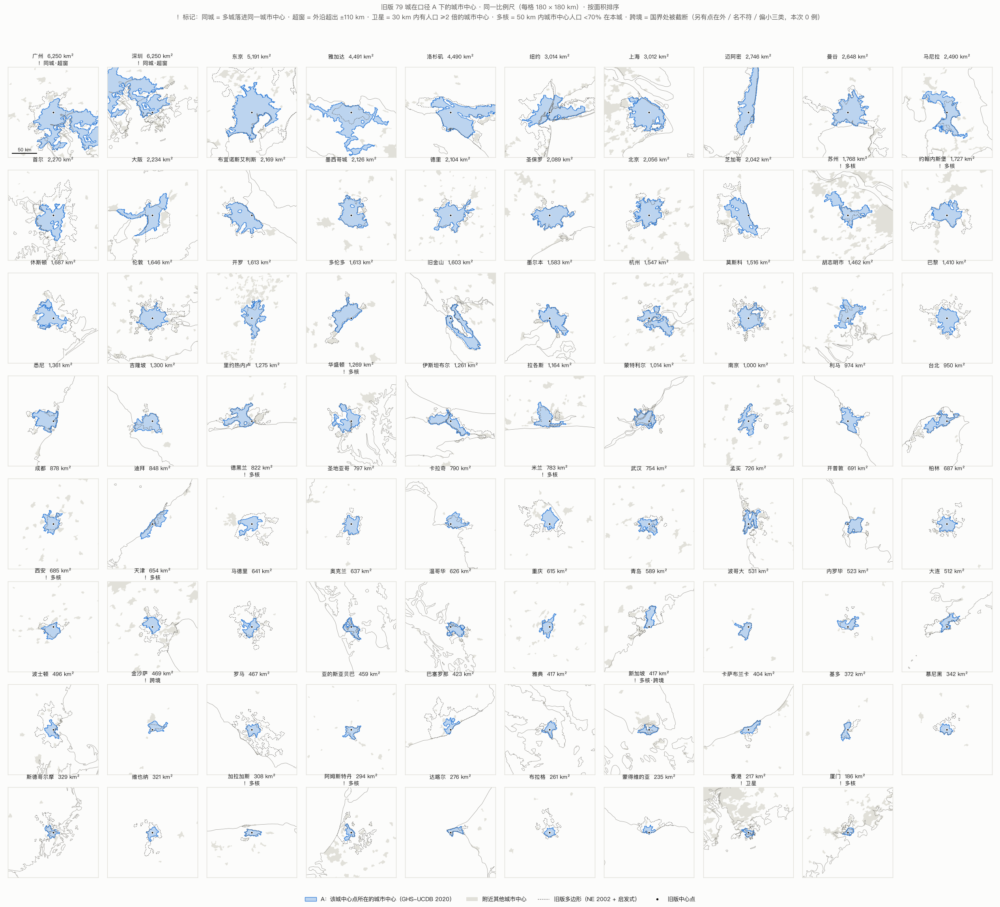

# P1b 口径 A 在旧版全部 79 城上的检验

> 2026-10-25 · GHS-UCDB R2024A v1.2，2020 年城市中心 · 中心点沿用旧版 `extract-urban-areas.js` 的 79 个显示城市（14 个隐藏的影子种子不计）
> 产物：[`pipeline/out/p1b/`](../pipeline/out/p1b/)：逐城表 `a_all_cities.csv`、同城分组 `a_shared_groups.csv`、等比例图集 `fig_atlas_a.png`

## 结论

**A 可以直接用于全部 79 城，数据层面没有发现错误。**

- 79 个旧中心点全部落在某个城市中心内。
- 城市中心的名称全部能与城市名对上。
- 没有人口低于 1 M 的城市中心。

被标记的 15 城都不是数据问题，而是 3 个需要拍板的产品问题（文末）。

| 检查规则 | 命中 | 城市 |
|---|---|---|
| 中心点不在任何城市中心内 | 0 | — |
| 城市中心名称不含该城市名 | 0 | — |
| 城市中心人口 < 1 M | 0 | — |
| 多城落进同一城市中心 | 2 | 广州、深圳 |
| 城市中心外沿超出 ±110 km 窗口 | 2 | 广州（126 km）、深圳（130 km） |
| 30 km 内有人口 ≥ 2 倍的城市中心（"卫星"） | 1 | 香港 |
| 区域多核：50 km 内城市中心人口 < 70% 在本城 | 11 | 新加坡、西安、天津、苏州、厦门、德黑兰、阿姆斯特丹、米兰、华盛顿、加拉加斯、约翰内斯堡 |
| 边界 10 km 内有别国城市中心（UCDB 在国界处切开） | 2 | 新加坡（新山）、金沙萨（布拉柴维尔） |

规则阈值都写在 [`src/citydef/p1b.py`](../pipeline/src/citydef/p1b.py) 开头。距离一律在以该城中心为原点的等积投影里量。

## 逐个判读

| 城市 | 标记 | A 下的情况 | 判读与建议 |
|---|---|---|---|
| 广州、深圳 | 同城 · 超窗 | 同属一个城市中心：6,250 km²，41.2 M，成员含深圳、广州、佛山、东莞、江门、中山…… | 珠三角在 ≥1,500 人/km² 的尺度上本来就是连成一片的。**需要拍板**：合并成一个条目"珠三角（广州–深圳）"，还是保留两个条目、各取 A ∩ 本市市域 |
| 香港 | 卫星 | 217 km²，4.81 M，只覆盖港岛和九龙一带。屯门（1.1 M）单独成一个城市中心，两块边界只隔 2 km；珠三角城市中心的边界在 13 km 外 | "卫星"是误报：被珠三角的体量触发。深港之间有 13 km 的真实形态断开，香港单独成城是合理的。但香港自身被山体切开，A 只覆盖全港约 65% 的人口，需要在界面上注明 |
| 天津 | 多核 | 中心城区 654 km²，7.25 M。滨海新区（1.4 M，距中心点 16 km）是独立的城市中心 | 两块之间只隔约 2 km 未达标的地带（1–2 个 1 km 网格），按定义就分成了两块（见下方"窄缝敏感"）。接受，城市卡片里注明"滨海新区为独立城市中心，相隔约 2 km" |
| 苏州 | 多核 | 苏州与无锡同属一个城市中心（1,768 km²，10.5 M）。43 km 外是上海（27.7 M） | 被标记是因为上海就在附近，不是自身破碎。显示名应为"苏州–无锡" |
| 厦门 | 多核 | 186 km²，1.80 M。漳州（1.5 M）在 4 km 外，泉州（3.5 M）在 34 km 外 | 海湾把城市切成了几块。接受，在界面上注明 |
| 西安 | 多核 | 685 km²，5.43 M。咸阳（0.6 M）在 14 km 外 | 西咸之间仍有断开。接受 |
| 德黑兰 | 多核 | 822 km²，8.89 M。卡拉季（3.3 M）在 27 km 外 | 旧版要靠影子种子才能切开，A 天然就是分开的。接受 |
| 阿姆斯特丹 | 多核 | 294 km²，1.18 M。鹿特丹–海牙（2.1 M）在 41 km 外，乌得勒支在 25 km 外 | 兰斯塔德本来就是多中心结构。接受 |
| 米兰 | 多核 | 783 km²，3.14 M。贝加莫、布斯托阿西齐奥各自独立 | 伦巴第是多中心结构。接受 |
| 华盛顿 | 多核 | 1,269 km²，3.35 M。巴尔的摩（1.1 M）在 46 km 外 | 两城分开，符合常识。接受 |
| 加拉加斯 | 多核 | 308 km²，2.62 M。瓜雷纳斯、拉瓜伊拉被山体隔开 | 接受 |
| 约翰内斯堡 | 多核 | 1,727 km²，7.82 M。比勒陀利亚（1.7 M）在 43 km 外 | 豪登省是多中心结构。接受 |
| 新加坡 | 多核 · 跨境 | 417 km²，5.01 M。新山（马来西亚，1.6 M）隔柔佛海峡与之相接，巴淡岛（印尼，1.3 M）在 26 km 外 | UCDB 按国界切开城市中心。这是国际统计的惯例，接受 |
| 金沙萨 | 跨境 | 469 km²，10.1 M。布拉柴维尔（刚果共和国，2.8 M）隔刚果河与之相接 | 同上，接受 |

**"多核"这一标记本身不需要处理。** 它是给界面准备的信息：A 只统计本城的城市中心，相邻的城市中心可以在地图上用浅灰色画出来，作为背景。

**A 也有"窄缝敏感"。** 两块城市中心之间只要隔着约 2 km 未达标的地带，就会分成两个城市，例如天津–滨海、香港–屯门。

- 这和 P1 里 B 的阈值断裂是同一类现象，只是尺度小得多。
- 区别在于 A 的规则是国际标准，固定不变，不由我们调。
- 因此界面要能把相邻城市中心一起画出来，不能只画一块。

## A 会把哪些知名城市并进来

这项没有作为异常规则，但它决定了界面上怎么给城市命名。成员列表取自 UCDB 的 `GC_UCN_LIS_2025`。

| 条目 | A 中包含的其他知名城市 |
|---|---|
| 东京 | 横滨、川崎、埼玉、千叶 |
| 大阪 | 神户、京都、堺 |
| 广州 / 深圳 | 佛山、东莞、江门、中山 |
| 苏州 | 无锡 |
| 杭州 | 绍兴 |
| 台北 | 新北、桃园、基隆 |
| 首尔 | 仁川、水原、高阳 |
| 旧金山 | 圣何塞、奥克兰（整个湾区） |
| 迪拜 | 沙迦、阿治曼 |
| 德里 | 古尔冈、诺伊达、加济阿巴德 |
| 雅加达 | 勿加泗、丹格朗、德波、茂物 |
| 纽约 | 纽瓦克、泽西城、扬克斯 |
| 迈阿密 | 劳德代尔堡 |

建议界面显示"主名 + 含 X、Y"，例如"东京（含横滨、川崎、埼玉、千叶）"，让用户一眼看出比较的是什么。

## 旧版面积有多离谱

旧版面积 ÷ A 面积：

- 中位数 1.39 倍，范围 **0.33–8.1 倍**。
- 79 城中只有 21 城落在 ±25% 以内。
- 25 城被旧版高估 2 倍以上，9 城被低估到 2/3 以下。

| 旧版高估最多 | 旧版 / A | 旧版低估最多 | 旧版 / A |
|---|---|---|---|
| 巴塞罗那 3,424 → 423 | 8.1 倍 | 迪拜 276 → 848 | 0.33 倍 |
| 罗马 2,850 → 467 | 6.1 倍 | 雅加达 1,540 → 4,491 | 0.34 倍 |
| 阿姆斯特丹 1,616 → 294 | 5.5 倍 | 苏州 689 → 1,768 | 0.39 倍 |
| 波士顿 2,455 → 496 | 5.0 倍 | 胡志明市 696 → 1,462 | 0.48 倍 |
| 马德里 2,811 → 641 | 4.4 倍 | 金沙萨 227 → 469 | 0.48 倍 |
| 蒙得维的亚 973 → 235 | 4.1 倍 | 深圳 3,127 → 6,250 | 0.50 倍 |
| 天津 2,657 → 654 | 4.1 倍 | 马尼拉 1,268 → 2,490 | 0.51 倍 |
| 米兰 3,156 → 783 | 4.0 倍 | 重庆 406 → 615 | 0.66 倍 |

规律很清楚：

- **欧洲被高估最多**（中位数 2.4 倍）。1 km 的 MODIS 像元加上旧版的连片扩张规则，把周边城镇都吞了进来。
- **2000 年以后快速扩张的城市被低估**：迪拜、雅加达、胡志明市、金沙萨、中国城市。这是 2002 年数据过时造成的。

## 图集



所有格子用同一比例尺，每格 180 × 180 km，按面积从大到小排列：

- **蓝色**：A。
- **浅灰**：附近的其他城市中心。
- **虚线**：旧版多边形。
- **黑点**：旧版中心点。

## 需要拍板的 3 件事

1. **珠三角怎么呈现。** 有两种做法：
   - (a) 合并成一个条目"珠三角（广州–深圳）"，与定义保持一致；
   - (b) 保留广州、深圳两个条目，各取 A ∩ 本市市域。这需要加一层市域边界数据，"深圳"的面积和人口也会随之变成"珠三角城市中心在深圳市境内的部分"。

   同样的问题也适用于湾区、苏锡、杭绍等，只是这几处旧版只列了其中一城，所以目前不冲突。
2. **显示名是否采用"主名 + 含 X、Y"。** 用户会看到东京其实包含横滨、旧金山其实是整个湾区。
3. **等比例视窗。** 珠三角从广州中心点量起，外沿达 126 km（从深圳量是 130 km），洛杉矶和迈阿密约 105 km。v2 的叠加视图要么支持缩放，要么默认窗口取 ±130 km。

## 复现

```bash
cd city-scale-v2/pipeline
uv run python -I -m citydef.p1b   # 约 45 s，只用 UCDB 矢量，不需要额外下载
```

旧版中心点一次性导出到 [`references/old_cities.csv`](../pipeline/references/old_cities.csv)：从旧脚本里按文本解析，没有执行旧脚本。此后 v2 不再读取旧仓库的脚本。
