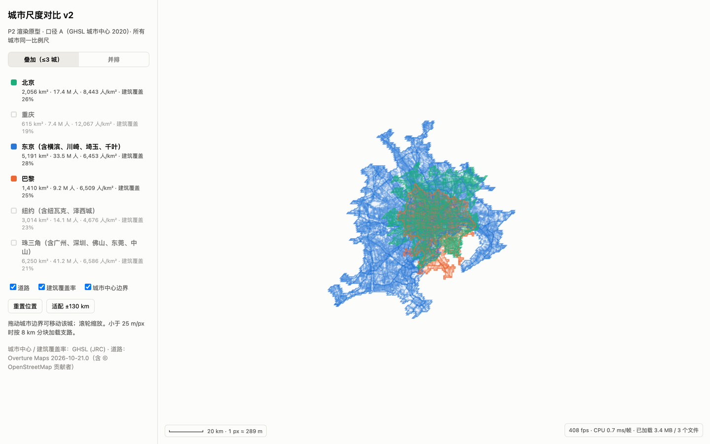
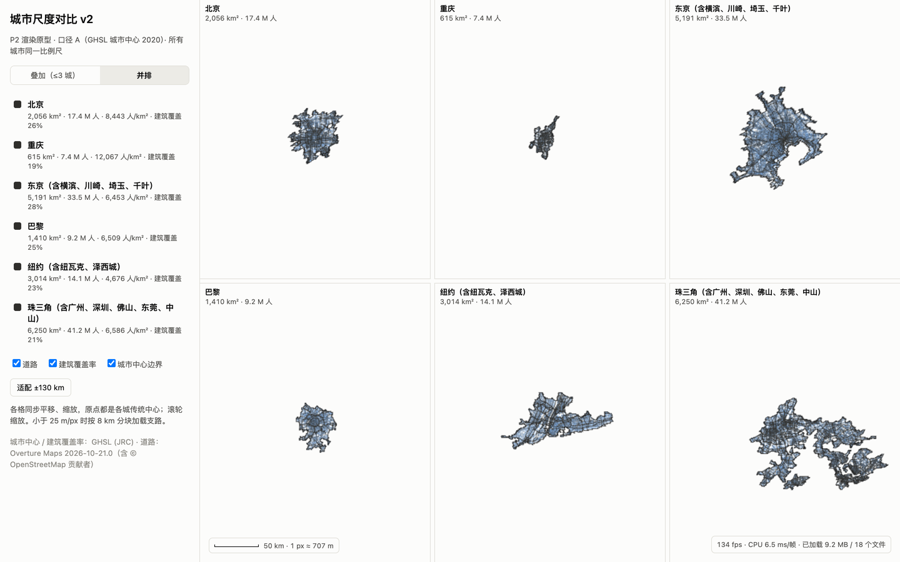
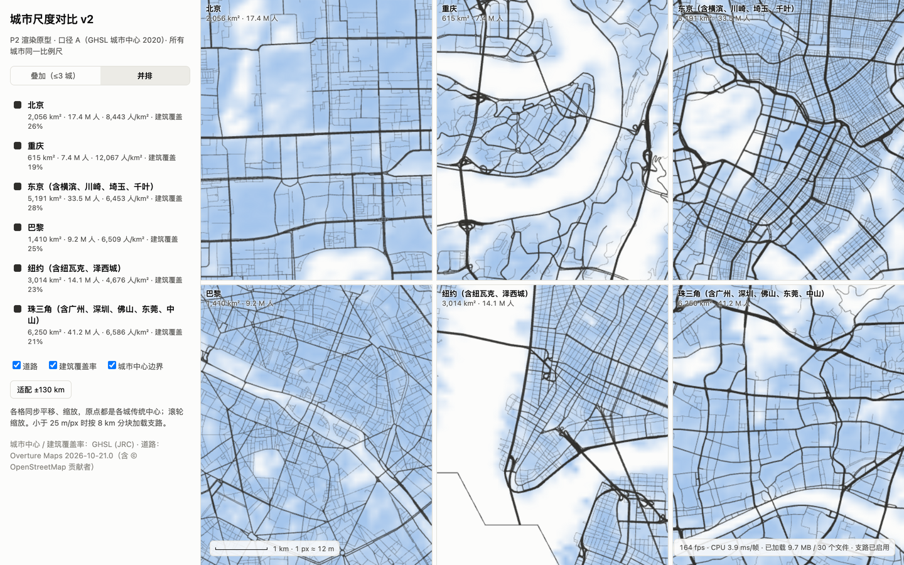
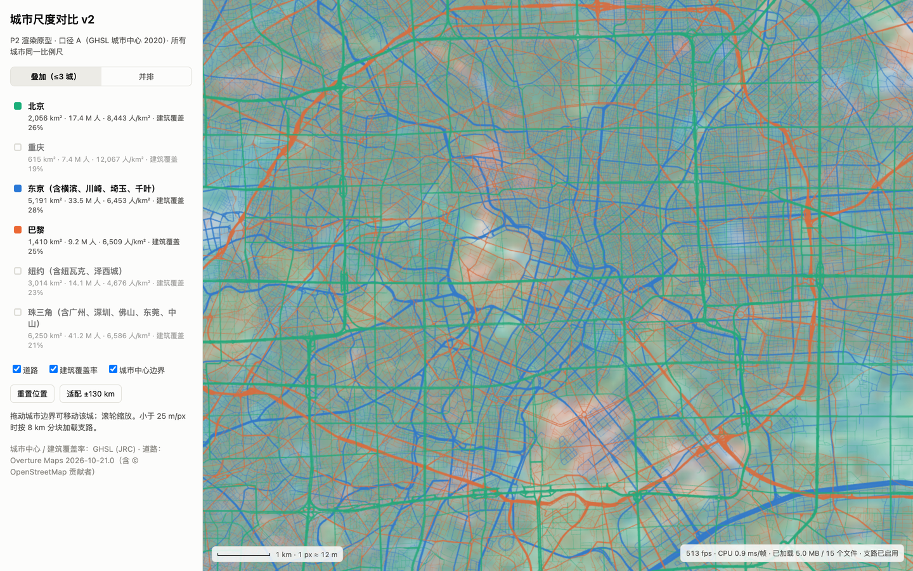

# P2 渲染原型：deck.gl + 每城局部米制坐标 + 按需分块

> 2026-10-25 · 口径 A（GHS-UCDB 2020 城市中心）· 6 个条目：北京、重庆、东京、巴黎、纽约、珠三角
> 代码：[`pipeline/src/citydef/export.py`](../pipeline/src/citydef/export.py)（数据导出；P2 时名为 `p2_export.py`，P3 改名并扩展）、[`web/`](../web/)（前端）、[`web/scripts/bench.mjs`](../web/scripts/bench.mjs)（基准测试）

## 结论

架构验证通过。总体上性能已不是问题，接下来的工作重心是数据和指标。

1. **性能有余量。** 测试条件：M3 Pro，1440×900 @2x，真实 GPU。
   - 3 城叠加、每帧拖动一城：平均 2.6 ms/帧。
   - 6 格并排、同步平移：总览 5.4 ms/帧，街道级（含支路）4.7 ms/帧。
   - 所有场景的 p95 都不超过 9.1 ms，远低于 60 fps 的 16.7 ms 预算。
   - 对比旧版：Canvas 2D 只画东京一城，一帧就要 10–20 ms，而且只画了下载顶点的 4%。
2. **数据按需加载。**
   - 总览只需主干路 + 建筑覆盖率图 + 边界：东京 2.5 MB，6 城合计约 10 MB。
   - 支路按 8 km 分块，缩放到 25 m/px 以下才加载可见的块。
   - 实测 6 格街道级累计只加载了 9.7 MB 道路数据（含总览的主干路），另有覆盖率 PNG 共 2.4 MB。
3. **"叠加"最多 3 城，多城比较要用"并排"。**
   - 6 城叠在一起，总览是一团颜色，街道级是一团乱线，这条路走不通。
   - 并排等比例小图才是多城比较的主视图。街道级并排时形态差异一眼可见（图 D）：北京的大街坊、重庆两江夹出的渝中半岛、东京的细密路网、巴黎的放射轴线、纽约的方格网。

## 做了什么

**数据导出**（P2 时为 `p2_export.py`，现为 `export.py`；每个条目 1–20 秒）：

- **城市中心**：取 GHS-UCDB 2020 的多边形。坐标转到该条目自己的等积方位投影（原点是主名城市的传统中心）。浏览器端完全不做投影，等比例由数据本身保证，叠加只是平移。
- **道路**：用 DuckDB 按 bbox 查 Overture `2026-10-21.0`（结果缓存在本地）。
  - 只保留机动车道路：motorway、trunk、primary、secondary、tertiary、residential、living_street、unclassified。footway、service 等不要：仅巴黎中心区，footway 的长度就是 residential 的 5 倍。
  - 处理流程：裁到城市中心以内 → 合并相连的线段 → 简化（主干路 5 m，支路 2 m）→ 分 4 个线宽等级。
- **文件格式**：主干路一个二进制文件；支路按 8 km 分块存放。格式是 `uint32 头长度 | JSON 头 | float32 坐标 | uint32 路径起点`，4 字节对齐，浏览器端"解码"只是建 TypedArray 视图，不需要 Worker。
- **建筑覆盖率**：GHS-BUILT-S 2020 的 100 m 栅格，转成 PNG，城市中心以外透明。
- **索引**：一个 `cities.json`，包含显示名（"主名 + 含 X、Y"）、A 的面积、人口、建筑面积，以及各文件的位置。

**前端**（Vite + React + TypeScript + deck.gl 9.4）：

- **视图**：正交视图，单位是米。
- **叠加模式（≤3 城）**：
  - 颜色只用参考调色板中前 3 个两两可区分（含色弱）的颜色。
  - 城市在画面上时颜色固定，不随列表顺序改变。
  - 拖动城市边界时只改它的平移矩阵，几何数据始终留在 GPU 上，不重新上传。
- **并排模式（任意城数）**：一个 WebGL 画布里放多个视图，每格只渲染自己那座城市。各格同步平移和缩放，原点都是各城的传统中心。所有格子用同一套样式，颜色不承担区分城市的作用，靠格子标题标明城市。
- **按缩放分层显示**：
  - 道路按等级区分线宽和透明度。拉远时路线变细变淡，让建筑覆盖率显出来；拉近时覆盖率淡出，让路网承担细节。
  - 小于 25 m/px 时加载视野内的支路块；视图静止 150 ms 后才发请求。
- **HUD**：显示 fps、每帧 CPU 时间、已加载的数据量和文件数。

## 性能实测

测试方法：系统 Chrome 无头模式，ANGLE Metal（Apple M3 Pro），1440×900 @2x，关闭帧率上限。每个场景连续 300 帧，每帧拖动城市或平移视图，统计帧间隔。这测的是开发版，生产构建的 CPU 开销会更低。

| 场景 | 平均 | p95 | 最大 | 累计已加载道路数据 |
|---|---|---|---|---|
| A 叠加 3 城 · 总览 ±130 km · 每帧拖动东京 | 2.6 ms | 4.7 ms | 5.9 ms | 3.4 MB |
| B 叠加 3 城 · 12 m/px 含支路 · 每帧平移 | 2.5 ms | 3.7 ms | 4.9 ms | 5.0 MB |
| C 并排 6 格 · 总览 · 每帧同步平移 | 5.4 ms | 8.4 ms | 10.5 ms | 9.2 MB |
| D 并排 6 格 · 12 m/px 含支路 · 每帧同步平移 | 4.7 ms | 9.1 ms | 11.7 ms | 9.7 MB |

原始结果在 `web/bench-out/bench.json`，复现命令见文末。

## 数据量（每个条目）

| 条目 | 城市中心 km² | 主干路 km | 支路 km | 主干路顶点 | 支路顶点 | 总览 MB | 支路 MB | 合计 MB |
|---|---|---|---|---|---|---|---|---|
| 北京 | 2,056 | 11,059 | 6,362 | 82k | 116k | 1.0 | 1.1（55 块） | 2.1 |
| 重庆 | 615 | 4,485 | 1,076 | 50k | 26k | 0.5 | 0.2（21 块） | 0.8 |
| 东京 | 5,191 | 23,576 | 59,039 | 207k | 2,004k | 2.5 | 19.1（127 块） | 21.7 |
| 巴黎 | 1,410 | 5,544 | 11,307 | 79k | 308k | 0.9 | 2.9（40 块） | 3.8 |
| 纽约 | 3,014 | 11,351 | 24,056 | 98k | 453k | 1.3 | 4.3（79 块） | 5.6 |
| 珠三角 | 6,250 | 32,336 | 18,509 | 308k | 341k | 3.7 | 3.2（164 块） | 6.8 |

"主干路"指 motorway 到 tertiary；"总览"包括主干路和建筑覆盖率 PNG。所有文件都是未压缩大小。

## 截图



**A：叠加 3 城，总览。** 东京（蓝）、巴黎（橙）、北京（绿）以各自传统中心对齐，同一比例尺。拖动任一城的边界可以把它挪开对比。



**C：并排 6 格，总览。** 每格 ±130 km，同一比例尺。可以直接看出：珠三角和东京是巨型连片区，重庆被山水切得很小，纽约沿长岛伸出一条臂。



**D：并排 6 格，12 m/px，传统中心周边。** 街道形态的对比一目了然。北京格子里支路稀疏，原因见下一节，并不是真实差异。



**B：叠加 3 城，街道级。** 3 种颜色还能分清，但三层覆盖率底色叠在一起偏浑。

## 需要你知道的数据问题

**中国城市的支路数据严重缺失。** 城市中心范围内的支路长度：

| 条目 | 支路 | 同范围主干路 |
|---|---|---|
| 北京 | 6,362 km | 11,059 km |
| 重庆 | 1,076 km | — |
| 东京 | 59,039 km | — |
| 纽约 | 24,056 km | — |
| 巴黎 | 11,307 km | — |

- 这不是真实差异。Overture 的道路以 OpenStreetMap 为主，而 OSM 在中国的覆盖不完整。
- 后果之一：中国城市在街道级视图里会显得路网稀疏，图 D 中的北京就是这样。
- 后果之二：路网密度、交叉口密度这类指标不能跨国比较。

可选的处理方式：

- 界面上对中国城市标注"支路数据不完整"。
- 跨国指标只用主干路（主干路的完整度明显更好）。
- 形态指标改用建筑数据（GHS-BUILT-S，或 Overture buildings），这类数据对各国更一致。

## 已知不足

- **总览加载可以再减。** 主干路可以再加一级粗简化（约 30 m），预计 6 城总览从约 10 MB 降到约 3 MB。服务端开启 brotli 压缩，二进制文件还能再省三到五成。
- **JS 包偏大。** 916 KB（gzip 后 265 KB），主要是 deck.gl，可以按需拆分。
- **叠加模式的街道级底色偏浑。** 可以在街道级只显示道路。
- **尚未实现**：地图上的城市标签、触屏操作、表格视图（无障碍）、分享链接。
- **测试覆盖有限。** 基准只在 M3 Pro 的无头 Chrome 上测过，集显笔记本和手机需要再测。

## 建议的下一步（P3）

1. **跑满全部条目。** 把导出扩到约 80 个条目，按 P1b 的命名和合并规则，约需 1 小时。按每城 1–20 MB 估算，总量约 0.3–0.5 GB，适合放在 Cloudflare R2 上。
2. **指标面板。** 面积、人口、密度、建筑覆盖率、径向密度曲线（P1 已有计算代码），并支持多城对比。
3. **时间轴。** UCDB 的 1975–2030 边界可以直接接入，配合建筑覆盖率的各期数据。
4. **处理中国路网缺失。** 从上一节的三种方式中选定一种。

## 复现

```bash
# 数据（Overture 查询结果会缓存，第二次很快）
cd city-scale-v2/pipeline
uv run python -I -m citydef.export               # 写入 ../web/public/data/（P3 起为全部条目）

# 前端
cd ../web
pnpm install
node_modules/.bin/vite --port 5174                # http://localhost:5174/

# 基准测试（需开着开发服务器；使用系统 Chrome，无头模式，真实 GPU）
node scripts/bench.mjs http://localhost:5174/ bench-out
```
