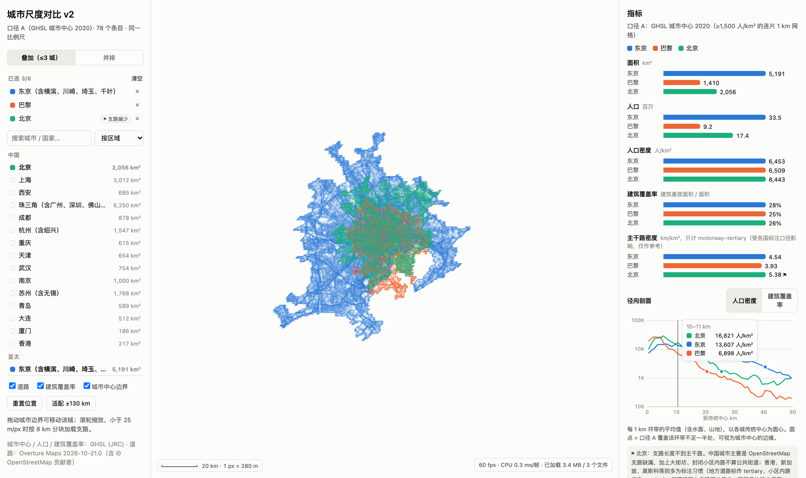
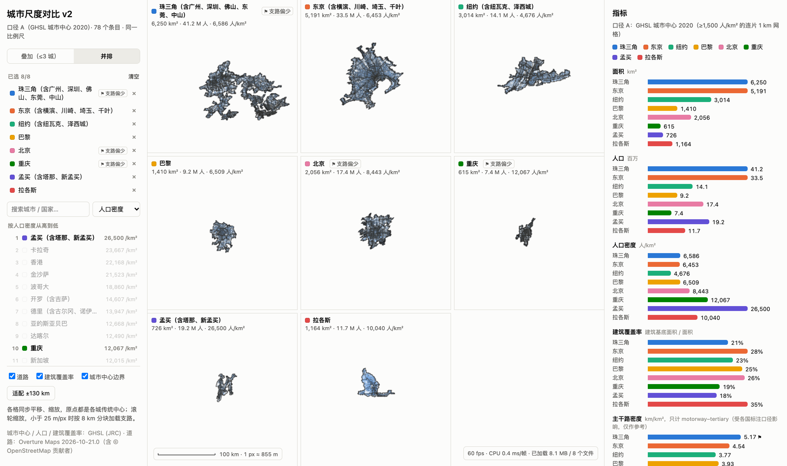
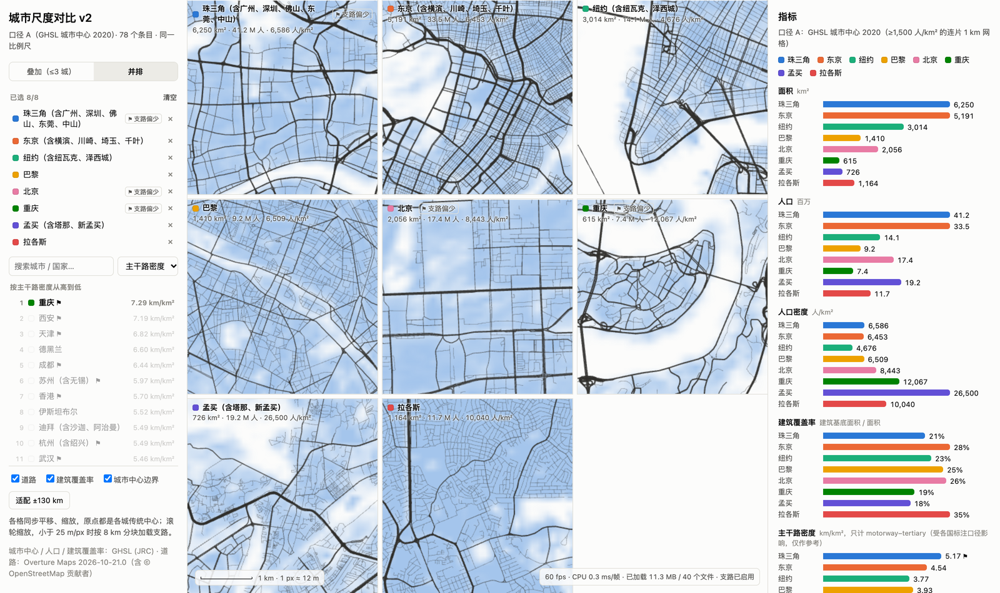

# P3 全部 78 个条目 + 指标面板

> 2026-10-25 · 口径 A（GHSL 城市中心 2020）· 条目登记表 [`pipeline/references/entries.csv`](../pipeline/references/entries.csv)
> 代码：[`export.py`](../pipeline/src/citydef/export.py)（导出 + 指标）、[`p3_summary.py`](../pipeline/src/citydef/p3_summary.py)（汇总）、[`web/src/MetricsPanel.tsx`](../web/src/MetricsPanel.tsx)（指标面板）
> 全部指标：[`pipeline/out/p3/metrics_all.csv`](../pipeline/out/p3/metrics_all.csv)
> **P4 更新：** 主干路密度已从指标面板移除，换成建筑形态指标，见 [`p4-building-form-metrics.md`](p4-building-form-metrics.md)。

## 结论

1. **78 个条目全部导出成功。** 旧版 79 城中，广州和深圳合并为"珠三角"，其余不变。
   - 前端数据共 262 MB：总览（主干路 + 覆盖率图）51 MB，支路 216 MB（分成 2,991 块）。
   - 索引 `cities.json` 只有 127 KB，打开页面只需请求这一个文件。
   - 整轮导出约半小时，大部分时间花在下载并解压 GHSL 瓦片上（落盘 5.7 GB）。瓦片和 Overture 查询都有缓存，重跑约 10 分钟（3 个进程合计 27 分钟的计算）。
2. **前端的城市浏览与指标面板已就位。**
   - 城市浏览：78 城可搜索、按区域分组，或按任一指标排序并显示名次。最多同时选 8 城。
   - 颜色：每座城市一个固定的颜色位，地图、格子标题和图表共用。
   - 指标面板：面积、人口、人口密度、建筑覆盖率、主干路密度的条形对比，以及径向剖面（人口密度或建筑覆盖率随距离的变化）。悬停有逐环读数，圆点标出口径 A 的边缘。
3. **性能仍有余量。** 最坏情况是并排显示最大的 8 个城市中心：平均 6–7 ms/帧，p95 不超过 11 ms。叠加 3 城、每帧拖动：1.8 ms/帧。
4. **中国支路问题按约定做了处理，但数据显示"只比主干路"只能部分缓解。**
   - 约定的处理已落地：界面上标"⚑ 支路偏少"，跨国路网指标只用主干路。
   - 但主干路密度本身也有偏差：中国城市的中位数比其他城市高 51%，主干路密度前 10 名中有 7 个是中国城市。原因是很多城市道路在 OSM 中被标成 tertiary 以上，加上大街坊的城市形态。
   - 因此主干路密度在界面上已注明"仅作参考"。详见下文。

## 做了什么

**条目登记表**（[`entries.py`](../pipeline/src/citydef/entries.py) 生成 `entries.csv`，此后以这个 CSV 为准）：

- **合并**：广州 + 深圳 → 珠三角，锚点取广州传统中心。
- **显示名**：沿用 P1b 规则"主名 + 含 X、Y"，只列作为独立城市广为人知的成员，共 23 个条目带"含"。例如杭州（含绍兴）、旧金山（含圣何塞、奥克兰）、开罗（含吉萨）。
- **锚点修正**：迈阿密、伊斯坦布尔的旧中心点当初是为了迁就旧算法而挪开的，已改回传统中心（迈阿密市中心、伊斯坦布尔历史半岛）。

**导出**（[`export.py`](../pipeline/src/citydef/export.py)，由 P2 的 `p2_export.py` 改名扩展而来）：

- 先串行下载所需的 GHSL 瓦片，再用 3 个进程并行处理各条目。已完成的条目自动跳过；单个条目失败不影响其他条目。
- 每个条目产出：
  - `boundary.json`、`builtup.png`、道路二进制文件（同 P2）；
  - `manifest.json`：支路分块清单，选中该城后才加载；
  - `record.json`：名称、A 的统计、指标、径向剖面。
- 所有 `record.json` 汇总成索引 `cities.json`。

**前端**：

- **城市浏览**：搜索框 + 排序（按区域 / 面积 / 人口 / 人口密度 / 建筑覆盖率 / 主干路密度）。
- **已选列表**：显示颜色，带"⚑ 支路偏少"和"未叠加"标签。
- **两种模式**：叠加模式只画占前 3 个颜色位的城市；并排模式画全部已选城市。
- **指标面板**：
  - 条形按选择顺序排列，每座城市在各个指标里的行位置不变，便于横向扫读。
  - 悬停任一城市，其他城市会淡化。
- **性能**：城市列表和指标面板做了 memo，平移、拖动时不再每帧重渲染。这一项把叠加拖动从 3.9 ms 降到 1.8 ms/帧。

## 指标定义

| 指标 | 定义 | 数据 |
|---|---|---|
| 面积 | 口径 A 城市中心的面积 | GHS-UCDB R2024A，2020 |
| 人口 | 城市中心内的常住人口 | 同上（基于 GHS-POP 2020） |
| 人口密度 | 人口 ÷ 面积 | — |
| 建筑覆盖率 | 建筑基底面积 ÷ 面积 | UCDB `MT_BUS_TOT`（基于 GHS-BUILT-S） |
| 主干路密度 | motorway、trunk、primary、secondary、tertiary 的总长度 ÷ 面积（km/km²） | Overture `2026-10-21.0`。双向分离的道路在 OSM 中按两条线计 |
| 径向剖面 | 以传统中心为圆心，每 1 km 环带内的人口密度、建筑覆盖率，以及 A 覆盖的比例（0–60 km） | GHS-POP / GHS-BUILT-S 100 m，重投影到各条目的局部网格 |
| 紧凑度、95% 外沿 | Angel 等（2010）的 proximity index；95% 面积所在的半径 | 由 A 栅格化后计算，导出了但界面暂未显示 |
| ⚑ 支路偏少 | 支路（residential、living_street、unclassified）总长度 < 主干路总长度 | 同主干路密度 |

## 78 城一览（部分）

| | 最高 | 最低 |
|---|---|---|
| 人口密度（人/km²） | 孟买 26,500 · 卡拉奇 23,667 · 香港 22,168 · 金沙萨 21,523 · 波哥大 18,860 | 迈阿密 2,019 · 休斯顿 2,288 · 奥克兰 2,386 · 墨尔本 2,387 · 芝加哥 2,588 |
| 建筑覆盖率 | 拉各斯 35% · 金沙萨 35% · 奥克兰 32% · 蒙得维的亚 32% · 布宜诺斯艾利斯 31% | 香港 13% · 斯德哥尔摩 14% · 卡萨布兰卡 16% · 马尼拉 17% · 华盛顿 18% |
| 主干路密度（km/km²，仅作参考） | 重庆 7.29 · 西安 7.19 · 天津 6.82 · 德黑兰 6.60 · 成都 6.44 | 金沙萨 1.01 · 拉各斯 1.76 · 内罗毕 1.96 · 雅加达 2.09 · 马尼拉 2.24 |

**密度和覆盖率要放在一起看。** 两个最能说明问题的例子：

- **奥克兰**：人口密度只有 2,386，建筑覆盖率却高达 32%。这是独栋低层住宅大面积铺开的形态。
- **香港**：人口密度高达 22,168，建筑覆盖率却最低，只有 13%。原因是高层塔楼加上城市中心内有大片山地。

## 中国路网问题：数字

"⚑ 支路偏少"规则命中 17 个条目：全部 15 个中国条目，加上莫斯科（0.63）和新加坡（0.71）。原因有两类：

1. **数据缺漏**：中国城市 OpenStreetMap 的支路缺得多。
2. **标注习惯**：香港、新加坡把很多地方道路标为 tertiary；莫斯科、新加坡的小区内道路多标为 service。

这两类都会让支路长度偏少，所以界面标签用中性的"支路偏少"，不用"支路不全"，并在脚注里说明两种原因。

按区域的中位数（km/km²）：

| 区域 | 主干路密度 | 支路密度 | 总路网密度 |
|---|---|---|---|
| 中国（15） | **5.46** | **2.63** | **8.06** |
| 亚太（18） | 4.06 | 8.57 | 11.89 |
| 欧洲（15） | 3.63 | 7.20 | 10.55 |
| 北美（12） | 4.02 | 7.02 | 10.94 |
| 南美（9） | 3.17 | 10.36 | 14.64 |
| 非洲（9） | 2.65 | 10.16 | 13.76 |

和其他区域合计相比，中国城市的主干路密度高 51%（5.46 vs 3.61），支路密度低 68%（2.63 vs 8.16），总路网密度低 31%（8.06 vs 11.68）。

这说明**没有一个基于 OSM 的路网指标，能在中国城市和其他城市之间公平比较**：

- **支路和总路网密度**：被中国的数据缺漏拉低。
- **主干路密度**：被中国把更多道路标为 tertiary 以上的做法拉高，也部分反映了大街坊形态的真实差异。

所以按约定"只比主干路"之后，界面上仍要注明这项指标仅作参考。

**建议**：城市形态的跨城比较以建筑数据为主（建筑覆盖率已在面板中；下一步可接入建筑体量 GHS-BUILT-V 和建筑轮廓），路网只作视觉参考。

## 性能

测试条件：系统 Chrome 无头模式，Apple M3 Pro 真实 GPU，1440×900 @2x，关闭帧率上限，每个场景 300 帧。

| 场景 | 平均 | p95 | 最大 | 累计已加载道路数据 |
|---|---|---|---|---|
| A 叠加 3 城 · 总览 · 每帧拖动 | 1.8 ms | 3.6 ms | 5.3 ms | 3.4 MB |
| B 叠加 3 城 · 12 m/px 含支路 · 每帧平移 | 2.3 ms | 4.0 ms | 4.3 ms | 5.0 MB |
| C 并排 6 格 · 总览 · 每帧平移 | 5.4 ms | 8.5 ms | 11.2 ms | 9.2 MB |
| D 并排 6 格 · 12 m/px · 每帧平移 | 4.1 ms | 6.0 ms | 9.4 ms | 9.7 MB |
| E 并排 8 格（最大的 8 个城市中心）· 总览 | 7.2 ms | 10.4 ms | 18.6 ms | 13.8 MB |
| F 并排 8 格（最大的 8 个城市中心）· 12 m/px | 5.9 ms | 11.0 ms | 14.1 ms | 17.1 MB |

## 截图



**叠加 3 城。** 右侧径向剖面悬停在 10–11 km 处：北京 16,821，东京 13,607，巴黎 6,898 人/km²。北京的密度在 10–20 km 环带仍然很高，但口径 A 的边缘（圆点）比东京近得多。



**并排 8 城，总览。** 左侧城市列表按人口密度排序。



**并排 8 城，12 m/px。** 列表按主干路密度排序：前 10 名里有 7 个是带 ⚑ 的中国城市，这正是上一节说的偏差。

## 已知不足与下一步

- **路网指标**：形态比较转向建筑数据（GHS-BUILT-V 体量；Overture buildings 的街区和建筑尺度）。在找到可用的中国道路数据之前，不再扩展路网指标。
- **双向分离道路**：主干路密度把双向分离道路按两条线计，对高速路网密集的城市偏高。可以按道路中心线去重，但收益有限。
- **时间轴**：1975–2030 尚未接入。UCDB 已有多时相边界，配合建筑覆盖率各期数据即可做城市扩张对比。
- **部署**：前端数据 262 MB，建议放 Cloudflare R2，应用本体放 Pages。需要先建 git 仓库和 CI。
- **体验**：缺地图上的城市标签、触屏操作、城市列表的键盘可达性、深色模式、分享链接（URL 状态）。
- **界面内容**：紧凑度和外沿已导出但界面未显示；建筑覆盖率径向剖面上，A 边缘圆点的含义还需要更清楚地说明。

## 复现

```bash
cd pipeline
uv run python -I -m citydef.entries      # 只在修改登记规则时运行；平时直接改 entries.csv
uv run python -I -m citydef.export       # 下载瓦片 + 导出全部条目（跳过已完成的；--force 全部重做）
uv run python -I -m citydef.p3_summary   # 汇总 → out/p3/metrics_all.csv

cd ../web
node_modules/.bin/vite --port 5174                                              # http://localhost:5174/city-scale-comparison/
node scripts/bench.mjs http://localhost:5174/city-scale-comparison/ bench-out   # 6 个帧时场景
node scripts/shots.mjs http://localhost:5174/city-scale-comparison/ shots       # 报告截图
```
