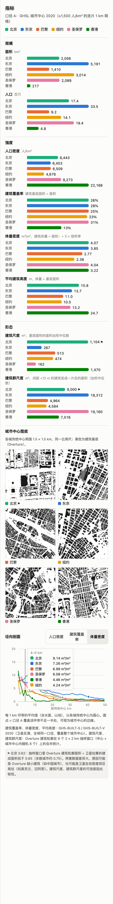
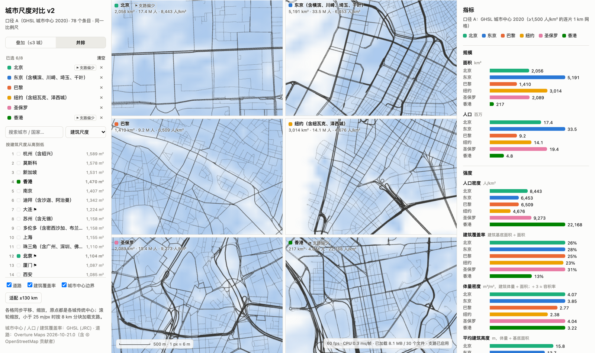

# P4 基于建筑的形态指标

> 2026-10-25 · 78 个条目 · 代码：[`buildings.py`](../pipeline/src/citydef/buildings.py)（Overture 抽样指标、图底）、[`export.py`](../pipeline/src/citydef/export.py)（GHSL 体量指标）、[`web/src/MetricsPanel.tsx`](../web/src/MetricsPanel.tsx)
> 全部数字：[`pipeline/out/p3/metrics_all.csv`](../pipeline/out/p3/metrics_all.csv)（含 P4 新列）

## 结论

1. **指标面板已从路网换成建筑。** "主干路密度"已移出面板和排序；面板分为"规模 / 强度 / 形态"三组，另有城市中心图底和径向剖面（新增体量密度）。路网数据仍用于地图显示，⚑ 支路偏少的标注保留。新增内容按数据来源分两类：
   - **卫星数据（GHSL，覆盖整个城市中心、全球同一口径）**：体量密度、平均建筑高度，加上原有的建筑覆盖率。
   - **Overture 建筑轮廓（抽样）**：建筑尺度、建筑群尺度，以及城市中心 1.5 km 图底缩略图。
2. **各区域的形态特征清楚，与城市形态研究的常识一致**（区域中位数）：

   | 区域 | 体量密度 m³/m² | 平均高度 m | 建筑尺度 m² | 建筑群尺度 m² |
   |---|---|---|---|---|
   | 中国（15） | 3.2 | 14.8 | 1,104 | 5,812 |
   | 亚太（18） | 2.7 | 11.2 | 482 | 10,516 |
   | 欧洲（15） | 2.3 | 10.9 | 672 | 5,732 |
   | 北美（12） | 2.3 | 9.4 | 401 | 5,220 |
   | 南美（9） | 3.0 | 10.5 | 202 | 13,760 |
   | 非洲（9） | 2.2 | 9.3 | 221 | 8,360 |

   - **中国城市**：高、单体大，是塔楼加大街坊的形态。
   - **拉美、非洲**：小建筑紧密连成大片。
   - **欧美**：居中，建筑被街道切成街块大小的群（约 5,000 m²）。
3. **数据可靠性有一个新发现。** 抽样窗口里 Overture 轮廓面积 ÷ 卫星建成面积，在测绘较完整的城市也只有约 0.75，说明卫星"建成面积"系统性地比真实建筑基底大约 1/3。
   - 低于 0.65 的 15 个条目被标 ⚑，其中不只是中国城市（北京 0.62、重庆 0.61、天津 0.64……），也有奥克兰 0.51、迈阿密 0.64 这类测绘很完整的城市。
   - 这说明比值低有两种原因：Overture 缺建筑，或卫星在低密度郊区高估。
   - 所以 ⚑ 的含义是"两套数据差异大，建筑尺度可信度较低"，而不是"中国数据缺失"。
4. **成本**：78 个条目的建筑和体量指标约 13 分钟（3 个进程并行，每个条目中位 28 秒），新增前端数据 2.5 MB（78 张图底 PNG）。

## 为什么抽样

试算（5 × 5 km 中心区）：Overture 建筑查询每 25 km² 需要 3–8 秒，东京一个城市中心（5,191 km²）全量查询要以小时计。因此 Overture 指标用抽样：

- **窗口**：每个条目 9 个 2 × 2 km 窗口。一个在传统中心，同时用来出图底；另外 8 个在城市中心内（距边界至少 1 km）均匀随机取点。随机种子由条目 id 决定，重跑结果完全一致。每城合计抽样 36 km²。
- **合并统计**：建筑在 9 个窗口间合并后再统计。
- **面积加权中位数**：用"一半的建筑基底面积属于至少这么大的建筑"，而不是按栋数取中位数。小棚屋、小建筑漏测时，按栋数的中位数会被明显拉偏，面积加权的受影响小得多。

卫星指标（体量、高度、覆盖率）不需要抽样：GHS-BUILT-S / GHS-BUILT-V 是 100 m 栅格，按整个城市中心统计。

## 指标定义

| 指标 | 定义 | 数据 |
|---|---|---|
| 建筑覆盖率 | 建筑基底面积 ÷ 城市中心面积 | GHS-BUILT-S 2020（UCDB） |
| 体量密度 | 建筑体量 ÷ 城市中心面积（m³/m²）。按约 3 m 层高，÷ 3 约等于容积率 | GHS-BUILT-V 2020 + GHS-BUILT-S |
| 平均建筑高度 | 建筑体量 ÷ 建筑基底面积（m） | 同上 |
| 建筑尺度 | 建筑基底面积的面积加权中位数（m²） | Overture 建筑轮廓 `2026-10-21.0`，9 个抽样窗口 |
| 建筑群尺度 | 把建筑栅格化（2 m）后做 6 m 闭运算，让间距小于 12 m 的建筑连成一片；再取连片面积的面积加权中位数（m²）。碰到窗口边缘的连片区不计 | 同上 |
| 图底 | 传统中心周围 1.5 × 1.5 km 的建筑基底，2 m 分辨率 | 同上 |
| 体量径向剖面 | 每 1 km 环带的建筑体量 ÷ 环带面积（含水面、山地） | GHS-BUILT-V 100 m |
| ⚑ 两套数据差异大 | 抽样窗口内 Overture 轮廓面积 ÷ GHSL 建成面积 < 0.65（多数城市约 0.75） | — |

**"建筑群尺度"不是地籍意义上的街区面积**，测的是"建筑之间是否连成片"：

- 巴黎、纽约的建筑被宽于 12 m 的街道切开，群就是一个街块（约 5,000 m²）。
- 东京、圣保罗、马尼拉的小建筑之间常是不足 12 m 的窄巷，会连成 1.8 万–3.5 万 m² 的大片。
- 中国的塔楼之间相距 20–50 m，各自独立，因此重庆只有 2,896 m²。

## 78 城中的极值

| 指标 | 最高 | 最低 |
|---|---|---|
| 体量密度 m³/m² | 西安 4.66 · 大阪 4.12 · 北京 4.07 · 圣保罗 4.04 · 加拉加斯 4.02 | 斯德哥尔摩 1.26 · 慕尼黑 1.41 · 马尼拉 1.42 · 卡萨布兰卡 1.49 · 雅加达 / 休斯顿 1.73 |
| 平均建筑高度 m | 香港 24.7 · 加拉加斯 18.6 · 首尔 17.8 · 重庆 17.3 · 武汉 17.0 | 慕尼黑 7.3 · 开普敦 7.4 · 迈阿密 8.0 · 伦敦 / 休斯顿 8.1 |
| 建筑尺度 m² | 杭州 1,589 · 莫斯科 1,578 · 新加坡 1,531 · 香港 1,470 · 南京 1,407 | 金沙萨 108 · 波哥大 117 · 亚的斯亚贝巴 133 · 里约 144 · 圣保罗 162 |
| 建筑群尺度 m² | 马尼拉 34,820 · 亚的斯亚贝巴 29,352 · 大阪 27,084 · 墨西哥城 24,672 · 雅加达 23,592 | 重庆 2,896 · 华盛顿 3,200 · 柏林 3,584 · 波士顿 3,968 · 金沙萨 4,080 |

**看形态要把强度和尺度放在一起看：**

- **体量密度相同，形态可以完全不同。** 北京（4.07）与圣保罗（4.04）的体量密度几乎相同，但建筑尺度相差 7 倍（1,104 vs 162 m²），建筑群尺度相差 2 倍（9,000 vs 19,160 m²）。一边是大体量单体加开敞空间，一边是小建筑紧密连片。
- **体量低，原因也可以不同。** 慕尼黑、斯德哥尔摩体量低，是因为城市中心里有大片开敞空间和低层住宅；马尼拉、雅加达体量低，主要是因为建筑矮（平均 8.2–8.4 m），尽管建筑之间连得很紧（建筑群尺度 2.4 万–3.5 万 m²）。

## ⚑ 数据差异：数字

各区域 Overture ÷ GHSL 的中位数：欧洲 0.79、南美 0.80、亚太 0.79、北美 0.75、中国 0.69、非洲 0.67。

低于 0.65 的 15 个条目：

| 条目 | 比值 |
|---|---|
| 奥克兰 | 0.51 |
| 金沙萨 | 0.56 |
| 大连、德黑兰、台北 | 0.58 |
| 约翰内斯堡 | 0.59 |
| 首尔、德里 | 0.60 |
| 开罗、重庆、蒙得维的亚 | 0.61 |
| 北京 | 0.62 |
| 天津、厦门、迈阿密 | 0.64 |

奥克兰和迈阿密也在里面，而这两地的建筑轮廓数据通常被认为相当完整（新西兰有官方测绘的建筑轮廓，美国有 Microsoft 的机器学习轮廓）。这说明这个比值不是纯粹的"完整度"：卫星的"建成面积"在低密度郊区会把车道、硬地、大屋顶一起算进去，从而偏大。

因此界面上的措辞是"两套数据差异大"，并在脚注写明两种原因。

中国城市的中位数 0.69，比欧洲的 0.79 低一截，符合 Overture 在中国缺小建筑的判断，但偏差远小于支路：中国支路密度比其他城市低 68%。

## 截图



**指标面板全貌**（北京、东京、巴黎、纽约、圣保罗、香港）。

- **图底**：北京的天安门、故宫、大会堂与胡同肌理，东京站周边的办公大楼，巴黎西岱岛，纽约下城，圣保罗中心的不规则街块，香港九龙的密集塔楼。
- **径向剖面**：切到"体量密度"，悬停在 4–5 km：北京 9.14，东京 7.26，巴黎 6.99，圣保罗 6.08，香港 4.46，纽约 4.24 m³/m²。香港、纽约在这一带被水面拉低。



**并排 6 城，6 m/px。** 左侧列表按建筑尺度排序。

## 局限

- **GHS-BUILT-V 是模型估算的体量**（由卫星和地形数据反演），单城误差可能不小。它包含非居住建筑，跨城比较比绝对值可靠。
- **Overture 指标基于抽样**，每城 36 km²。大城市中心（5,000 km² 级）的抽样比例不到 1%，有抽样误差；需要时可以增加窗口数。
- **建筑群尺度依赖 12 m 这个阈值**。它衡量的是"连片程度"，换阈值会改变数值，但不改变城市之间的相对排序。
- **图底只取中心 1.5 km**，用于直观示意，不代表全城形态。

## 复现

```bash
cd city-scale-v2/pipeline
uv run python -I -m citydef.export --force --no-roads   # 重算所有条目的体量与建筑指标（道路文件保留），约 13 分钟
uv run python -I -m citydef.p3_summary                  # 汇总（含 P4 列）

cd ../web
node scripts/shots_p4.mjs http://localhost:5174/ shots   # 报告截图
```
